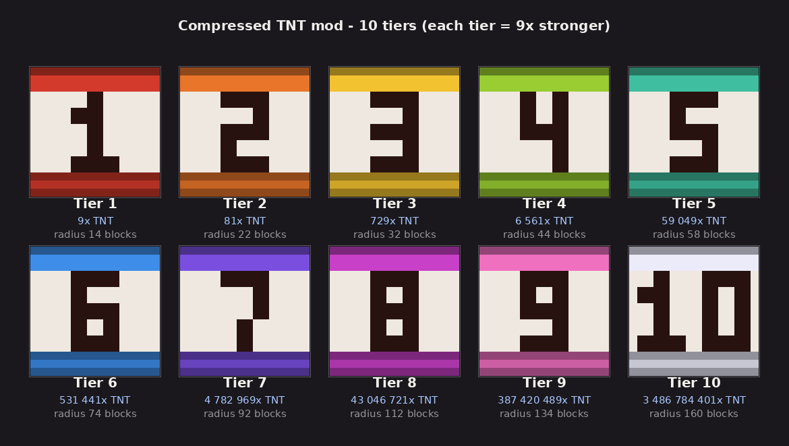

# TNT Minecraft

**۹ تا TNT → ۱ بلاک. حجم تخریب هر لِوِل دقیقاً ۹ برابر لِوِل قبل — تا لِوِل ۱۰. تایمر انفجار با کلیک‌راست برای همه‌ی TNT‌ها، حتی TNT معمولی ماینکرافت!**

ماد برای ماینکرافت **Java Edition 1.21.1** با لودر **Fabric**:
۹ عدد TNT را کنار هم بگذار تا یک بلاک فشرده ساخته شود؛ بعد همان را دوباره
فشرده کن و تا ۱۰ لِوِل جلو برو. **عددِ لِوِل هم روی اسمِ آیتم و هم درشت روی عکسِ بلاک** نوشته شده است.

## لِوِل‌ها و قدرت انفجار (نسبی: ۹ برابر ۹ برابر)

حجم تخریب هر لِوِل دقیقاً **۹ برابر** لِوِل قبل است؛ برای همین شعاع در هر لِوِل حدود ۲ برابر می‌شود:

| لِوِل | نام | ID | حجم تخریب نسبت به TNT | شعاع |
|:---:|:---|:---|:---:|:---:|
| 1 | Compressed TNT 1 | `compressedtnt:compressed_tnt` | 9x | 8 |
| 2 | Compressed TNT 2 | `compressedtnt:double_compressed_tnt` | 81x | 17 |
| 3 | Compressed TNT 3 | `compressedtnt:triple_compressed_tnt` | 729x | 36 |
| 4 | Compressed TNT 4 | `compressedtnt:quadruple_compressed_tnt` | 6,561x | 75 |
| 5+ | Compressed TNT 5 تا 10 | `compressedtnt:..._compressed_tnt` | 59,049x تا **~3.49 میلیارد x** | 128 (سقف موتور) |

- از لِوِل ۵ به بالا شعاع به سقفِ موتور بازی می‌رسد؛ قدرت اضافه به‌شکل قابلیت اضافه می‌آید:
  **لِوِل ۶+** ابسیدین را هم می‌ترکاند، **لِوِل ۷+** بدراک را هم (به جز کف دنیا).
- بلاک‌های Barrier و چانک‌های لودنشده هرگز خراب نمی‌شوند.

## تایمر انفجار — برای همه‌ی TNT‌ها، حتی TNT معمولی ماینکرافت!

1. روی بلاک TNT گذاشته‌شده، **دکمه‌ی راست ماوس را حدود ۱ ثانیه نگه دار.**
2. پیامی در چت می‌آید؛ در چت بنویس: `/tntfuse 120` (۱ تا ۶۰۰ ثانیه).
3. TNT همان لحظه چشمک می‌زند و دقیقاً بعد از همان ثانیه‌ها منفجر می‌شود.
4. بدون تایمر: مثل TNT معمولی با فندک و فولاد/ردستون روشن می‌شود (فیوز ۴ ثانیه).

## تی ان تی ماده‌ای: خاک، سنگ، محصولات

دستور ساخت ۳×۳ — چهار ماده در وسط ضلع‌ها + چهار باروت در گوشه‌ها
(برای محصولات از گندم). انفجار **هیچ دمیجی نمی‌زند**؛ فقط صدا می‌دهد و در
محدوده **۱۰×۱۰×۱۰** فقط بلوک‌های همان ماده را خالی می‌کند و آیتم‌ها را روی زمین می‌ریزد:

- **Dirt TNT**: دیپ، گرس‌بلاک، کورس‌دیرت، پادزول، فارملند و...
- **Stone TNT**: سنگ، گرانیت، دیورایت، اندیسایت، تاف، دیپ‌اسلیت و...
- **Crop TNT**: گندم، هویج، سیب‌زمینی، چغندر، هندوانه، خربزه، نیشکر و... (فارملند سالم می‌ماند)

## ویژگی‌ها

- رفتار کاملاً مثل TNT معمولی (فندک و فولاد، ردستون، انفجار زنجیره‌ای، فیوز ۴ ثانیه).
- باگ «بعضی بلوک‌ها بعد از انفجار می‌ماندند» رفع شد + گشتِ نهاییِ کل کره انفجار.
- فیزیک کامل: آب و گدازه به گودال برمی‌گردند؛ شن و ماسه می‌ریزند.
- تخریب بودجه‌بندی‌شده (بدون فریز سرور) + نگه‌داشتن چانک‌های ناحیه انفجار تا آخر موج.
- همه بلوک‌ها با دست/کلنگ فوراً شکسته می‌شوند و خودشان را می‌دهند.
- نام‌ها و پیام‌ها دو زبانه (انگلیسی + فارسی).

## تست خودکار

`testdata/` یک دیتاپک تست کامل است: شعاع دقیق هر لِوِل، صفرِ بلوکِ باقی‌مانده در
مکعب ۴۰×۱۹×۳۰، جریان آب، فیوز سفارشی (ماد + TNT ونیلا)، سه تی ان تی ماده‌ای
(فقط ماده‌ی خودش، آیتم‌دراپ، بدون دمیج — با یک گاوِ زنده داخل انفجار!) و پاک‌شدن
انتیتی‌ها. همه‌ی ۱۲ تست پاس می‌شوند (`TNTTEST_ALL_PASS`).

## ساخت

| ماد | دستور |
|:---|:---|
| Compressed TNT 1 | ۹ عدد TNT معمولی (۳×۳) |
| لِوِل بعدی | ۹ عدد از لِوِل قبل (۳×۳) |
| برگشت | یک لِوِل را بگذار → ۹ عدد لِوِل قبل می‌دهد |
| Dirt / Stone / Crop TNT | ۴ ماده + ۴ باروت |

## نصب

- کلاینت: Fabric Loader + Fabric API + این ماد در پوشه `mods`.
- سرور: همین دو فایل jar در پوشه `mods` سرور.

لیسانس MIT — ساخته‌شده توسط 021hk

